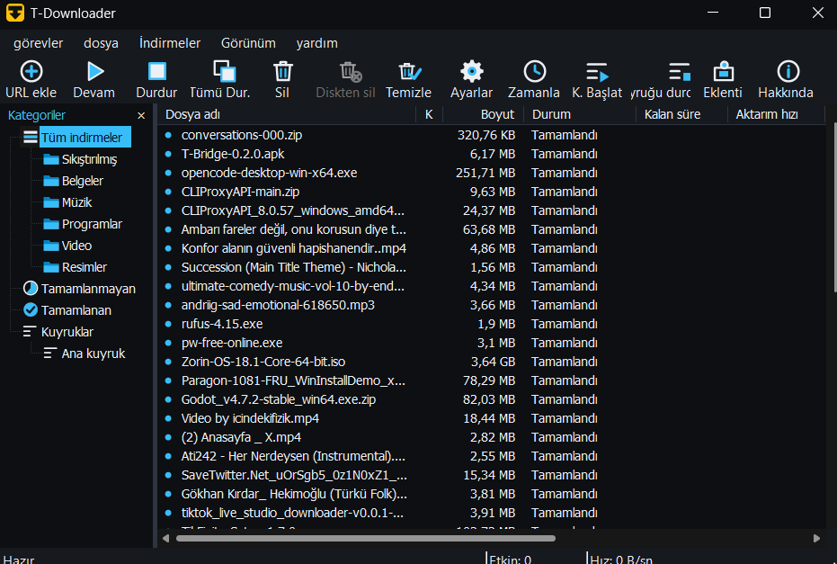

<div align="center">


<h1>T-Downloader</h1>

<p>
  <strong>Büyük dosyaları ve web medyalarını paralel parçalara bölerek en yüksek hızda indiren modern Windows indirme yöneticisi ve Manifest V3 tarayıcı eklentisi.</strong>
</p>

<p>
  <a href="https://github.com/taha-sa/t-downloader-releases/releases/latest">
    
  </a>
  
  
  <a href="https://github.com/taha-sa/t-downloader-releases/releases">
    
  </a>
</p>

<p>
  <a href="#-öne-çıkan-özellikler">Özellikler</a> •
  <a href="#-indir-ve-kur">İndir & Kur</a> •
  <a href="#-tarayıcı-eklentisi-kurulumu">Tarayıcı Eklentisi</a> •
  <a href="#-gizlilik-ve-güvenlik">Güvenlik</a> •
  <a href="#-t-suite-ekosistemi">T-Suite</a>
</p>

</div>

<p align="center">
  
</p>

> **Not:** Bu depo yalnızca resmi derlenmiş Windows kurulum dosyasını, taşınabilir (portable) arşivi, Manifest V3 tarayıcı eklentisini ve `SHA-256` doğrulama özetlerini barındırır.

---

## ✨ Öne Çıkan Özellikler

| Özellik | Detay |
|---|---|
| ⚡ **Çok Parçacıklı (Multi-Segment) Hızlandırma** | İndirmeleri paralel parçalara bölerek internet hattınızın tam kapasitesini kullanır; büyük arşivlerde ve ISO dosyalarında belirgin hız artışı sağlar. |
| 🧩 **Tarayıcı Eklentisi (Chrome / Edge / Brave)** | Manifest V3 + Native Messaging Host mimarisiyle tarayıcı indirmelerini otomatik olarak T-Downloader'a aktarır; video oynatıcılarının üzerinde tek tıkla indirme düğmesi sunar. |
| 🎬 **Video & HLS Akış İndirme** | HLS (`.m3u8`) akışlarını doğrudan ayrıştırır, çözünürlük/kalite seçimi sunar, oturum çerezlerini güvenle aktarır ve `yt-dlp` entegrasyonunu destekler. |
| ⏯️ **Duraklat, Devam Et & Kuyruk Yönetimi** | Bağlantı kopsa bile indirmeleri kaldığı yerden sürdürün; dosyaları kuyruklara ayırıp sırayla indirin. |
| ⏰ **Akıllı Zamanlayıcı (Scheduler)** | İndirme kuyruklarını belirlediğiniz saatte otomatik başlatın veya durdurun. |
| 🚦 **Hız Limiti & Disk Alanı Koruması** | Ağınızı kilitlememek için anlık hız sınırı koyun; hedef diskte yer azaldığında otomatik uyarı alın. |
| 📂 **Otomatik Kategorilendirme** | İndirilen dosyaları otomatik olarak *Sıkıştırılmış, Belgeler, Müzik, Programlar, Video ve Resimler* klasörlerine ayırır. |
| 🔐 **Dahili SHA-256 / Hash Doğrulama** | İndirdiğiniz dosyaların bütünlüğünü harici araç gerekmeden doğrudan uygulama içinden kontrol edin. |
| 🌙 **Tam Koyu Arayüz & İmzalı Güncelleme** | Göz yormayan koyu tema, ECDSA imzalı uygulama içi güncelleyici ve **T-Bridge Hub** entegrasyonu. |

---

## 📥 İndir ve Kur

### 👉 [En Son Sürümü İndir (Latest Release)](https://github.com/taha-sa/t-downloader-releases/releases/latest)

| Dosya | Açıklama | Platform |
|---|---|---|
| `T-Downloader-Setup-1.2.0.exe` | Resmi Windows kurulum paketi (Native Host kaydı dahil) | Windows 10/11 (x64) |
| `T-Downloader.zip` | Kurulumsuz taşınabilir (Portable) sürüm | Windows 10/11 (x64) |
| `T-Downloader-Extension-1.2.0.zip` | Tarayıcı eklentisi (Manifest V3) | Chrome, Edge, Brave |
| `SHA256SUMS.txt` | Bütünlük doğrulama özetleri | Tümü |

---

## 🌐 Tarayıcı Eklentisi Kurulumu

T-Downloader'ın tarayıcı indirmelerini otomatik yakalaması için masaüstü uygulamasını kurduktan sonra eklentiyi ekleyin:

1. `T-Downloader-Extension-1.2.0.zip` dosyasını indirip sabit bir klasöre çıkarın.
2. Tarayıcınızda uzantılar sayfasını açın:
   - Chrome / Brave: `chrome://extensions`
   - Edge: `edge://extensions`
3. Sağ üstten **Geliştirici modu (Developer mode)** anahtarını açın.
4. **Paketlenmemiş öğe yükle (Load unpacked)** düğmesine basıp çıkardığınız eklenti klasörünü seçin.

<details>
<summary><strong>📌 Kurulum Notları & SHA-256 Doğrulama</strong></summary>

<br/>

- **Windows SmartScreen:** İlk kurulumda uyarı ekranı çıkarsa **Ek bilgi → Yine de çalıştır** seçeneğini kullanabilirsiniz.
- **Taşınabilir Sürüm:** `T-Downloader.zip` dosyasını çıkarıp doğrudan `TDownloader.exe` dosyasını çalıştırabilirsiniz.

```powershell
Get-FileHash .\T-Downloader-Setup-1.2.0.exe -Algorithm SHA256
# Çıktıyı sürüm sayfasındaki SHA256SUMS.txt ile karşılaştırın.
```

</details>

---

## 💻 Sistem Gereksinimleri

- **İşletim Sistemi:** Windows 10 veya Windows 11 (64-bit)
- **Desteklenen Tarayıcılar:** Google Chrome, Microsoft Edge, Brave ve Chromium tabanlı tarayıcılar
- **Arayüz Dilleri:** Türkçe (TR) · English (EN) · Deutsch (DE)

---

## 🔒 Gizlilik ve Güvenlik

- **Sıfır Telemetri:** İndirdiğiniz bağlantılar, dosya geçmişiniz veya tarayıcı etkinliğiniz hiçbir harici sunucuya gönderilmez.
- **İmzalı Güncellemeler:** Uygulama içi güncellemeler ECDSA imzası ve SHA-256 özeti doğrulanmadan uygulanmaz.
- **Reklamsız & Temiz:** Ek yazılım, reklam penceresi veya arka plan izleyici içermez.

---

## 🧩 T-Suite Ekosistemi

| Uygulama | Ne İşe Yarar? | Platform | Sürüm Deposu |
|---|---|---|---|
| **T-Bridge** | Windows & Android arası dosya, pano, bildirim, kumanda ve T-Suite Hub | Windows, Android | [taha-sa/t-bridge-releases](https://github.com/taha-sa/t-bridge-releases) |
| **T-Downloader** *(bu depo)* | Çok parçacıklı indirme yöneticisi + video/HLS + tarayıcı eklentisi | Windows, Chrome/Edge/Brave | [taha-sa/t-downloader-releases](https://github.com/taha-sa/t-downloader-releases) |
| **T-DeskTree** | NTFS MFT ultra hızlı disk & klasör analizi + Treemap | Windows | [taha-sa/t-desktree-releases](https://github.com/taha-sa/t-desktree-releases) |
| **T-RamCash** | 5 katmanlı RAM temizleyici ve canlı sistem tepsisi izleyici | Windows | [taha-sa/t-ramcash-releases](https://github.com/taha-sa/t-ramcash-releases) |
| **T-Desk Viewer** | PDF, Office, EPUB, Kod & ZIP mobil belge görüntüleyici | Android | [taha-sa/tdesk-viewer-releases](https://github.com/taha-sa/tdesk-viewer-releases) |

<details>
<summary><strong>🇬🇧 English Summary</strong></summary>

<br/>

**T-Downloader** is a fast, ad-free multi-segment download manager for Windows paired with a Manifest V3 browser extension for Chrome, Edge, and Brave. Features parallel acceleration, HLS/video stream capture, pause/resume queues, scheduler, speed limiter, auto-categorization, built-in SHA-256 verification, and signed in-app updates. Zero telemetry; available in Turkish, English, and German.

</details>

---

<p align="center">
  Hata bildirimi veya özellik önerisi için <a href="https://github.com/taha-sa/t-downloader-releases/issues">Issues</a> sekmesini kullanabilirsiniz · <a href="https://github.com/taha-sa">T-Suite Ekosistemi</a>
</p>